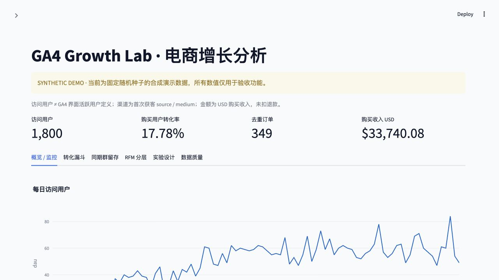
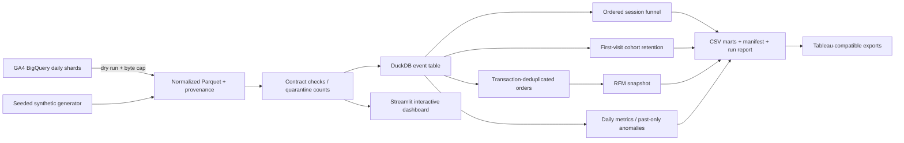

# GA4 Growth Lab · 电商用户增长分析工程

[](https://github.com/FugeJia/ga4-ecommerce-growth-analytics/actions/workflows/ci.yml)


基于 **Google GA4 电商公开数据结构**构建的可复现分析作品集：从事件契约、数据质量、有序漏斗到同期群留存、RFM、异常监控与实验设计。适用于产品分析、数据分析和数据工程面试演示。

> **当前交付状态：工程与合成演示已执行；尚未连接 BigQuery，未执行真实公开数据查询。**
> `examples/demo/` 的所有数字均来自 seed=42 的合成数据。BigQuery 接入 SQL 已做语法解析和客户端行为测试，但不等同于云端执行验证。没有真实 A/B 分组、改版、全量上线或业务收益证据。



## 这个项目解决什么问题

| 业务问题 | 交付内容 | 关键约束 |
|---|---|---|
| 商品浏览到支付哪里流失？ | 会话内四步有序漏斗、来源、设备与新老/未知用户拆分 | 防止乱序和不同用户同 session_id 串联 |
| 新客是否回来？ | 按周汇总的精确 D1 / D7 / D30 留存 | first_visit 入组，未成熟分母排除 |
| 哪些购买用户值得运营？ | RFM 与四类运营分层、本地名单导出 | 交易去重、固定观察时点、不公开用户明细 |
| 活跃与转化何时异常？ | 28 天历史 3σ 与周环比 | 不使用当日数据拟合基线，不声称因果归因 |
| 改版该如何评估？ | 样本量、SRM、卡方/Fisher、提升区间 | 上传独立实验数据；GA4 样例不提供实验 |
| 数据是否可信？ | 字段契约、隔离计数、冲突阻断、运行清单 | 完整性检查不等于埋点采集缺失率 |

## 5 分钟运行

需要 Python 3.12（项目声明 ≥3.11；CI 使用 3.12）。不需要 Google Cloud 或数据库服务。

```bash
git clone https://github.com/FugeJia/ga4-ecommerce-growth-analytics.git
cd ga4-ecommerce-growth-analytics
python3.12 -m venv .venv
source .venv/bin/activate
python -m pip install -r requirements.lock
python -m pip install --no-deps -e .
make demo
streamlit run app.py
```

打开终端显示的本地地址。看板包含日期、首次获客来源、设备筛选，以及概览、漏斗、留存、RFM、实验、质量六个页面。四步漏斗从 `view_item` 开始，独立的 session 计数不作为第一阶段。

`make demo` 会生成 `data/demo/events.parquet` 和 `artifacts/demo/`。为防止混淆数据版本，命令拒绝覆盖已有输入和构建目录；再次运行请指定新路径，例如：

```bash
ga4 demo --seed 7 --output data/demo-seed7/events.parquet
ga4 build --input data/demo-seed7/events.parquet --output artifacts/demo-seed7
streamlit run app.py -- --input data/demo-seed7/events.parquet
```

Docker（可选；本次未运行 Docker 验证）：

```bash
docker build -t ga4-growth .
docker run --rm -p 8501:8501 ga4-growth
```

## 真实 GA4 数据接入

来源：`bigquery-public-data.ga4_obfuscated_sample_ecommerce.events_*`，覆盖 2020-11-01 至 2021-01-31。它来自 Google Merchandise Store 网站，经过混淆，存在占位值及内部一致性限制。不能将它描述成自己运营的 App 或拿结果与实时 Demo Account 对账。[Google 数据说明](https://developers.google.com/analytics/bigquery/web-ecommerce-demo-dataset)

1. 准备自己的 Google Cloud project，启用 BigQuery API。Sandbox 可用于探索；本项目不会替你开通账单。
2. 在本机安装 Google Cloud CLI，使用应用默认凭据登录。执行账号需要 `bigquery.jobs.create` 以及读取公开数据的能力。
3. 先 dry run，再显式下载。默认每次查询上限 **10,000,000,000 bytes**；这是查询字节上限，不保证零费用。

```bash
gcloud auth application-default login
# 替换 YOUR_PROJECT_ID；默认命令只验证和估算扫描量。
ga4 extract --project YOUR_PROJECT_ID --start 2020-11-01 --end 2021-01-31
# 看过扫描量后执行；可先用一天做小范围验证。
ga4 extract --project YOUR_PROJECT_ID --start 2020-11-01 --end 2020-11-01 \
  --execute --output data/public-day/events.parquet
ga4 build --input data/public-day/events.parquet --output artifacts/public-day
streamlit run app.py -- --input data/public-day/events.parquet
```

全周期只需把 `--end` 改成 `2021-01-31` 并使用新目录。每天只导出一天时，D7/D30 会因观察期不足返回 NULL。程序保存查询 hash、job ID、扫描量、输入 SHA-256 和数据模式。`data/`、`artifacts/` 被 Git 忽略，真实用户标识不会自动进入公开仓库。认证只从 ADC 读取，不需要把密钥放入项目。

查询使用 `_TABLE_SUFFIX` 约束扫描范围，`event_params` 相关子查询不会与商品数组做笛卡尔展开。[查询与费用控制说明](https://docs.cloud.google.com/bigquery/docs/running-queries)

## 数据流程



BigQuery 提供抽取，DuckDB SQL 提供经过测试的共享指标逻辑；批处理和交互看板复用同一 Python 包。没有隐藏的远端数据库或付费服务依赖。本项目采用单机批处理，适合样例与作品集，不声称达到生产流量验证。

## 指标口径

- **访问用户 / DAU**：观察日有任意已收到事件的不同 `user_pseudo_id`，不是 GA4 UI 的 engagement-based Active users。匿名标识不代表跨设备自然人；不拼接 `user_id`。
- **购买用户转化率**：范围内有 purchase 的用户 / 范围内有任意事件的用户。范围聚合去重用户，不能对日比率直接平均。
- **漏斗**：同一 `(user_key, session_id)`，`view_item < add_to_cart < begin_checkout < purchase`。依次取首个满足时间条件的事件；相同时间戳视为顺序不明。日期切片后只使用片内事件，跨边界会话可能不完整。
- **渠道**：`traffic_source.source / medium` 为首次获客维度，不是会话末次点击归因。设备按事件记录，漏斗按会话内首次观察设备归属。
- **留存**：仅存在 `first_visit` 的用户进入 cohort。D7 是首访后第 7 个日历日有事件，不是第 1–7 天累计回访。按获客周汇总，但资格按用户实际获客日计算；未成熟为 NULL。
- **RFM**：以观察数据末日计算 R，F 为范围内去重交易数，M 为 USD 购买收入。未扣退款；收入缺失/负数的用户不进入四类名单。

完整边界、质量规则、分层策略见 [指标字典](docs/metrics.md)、[数据契约](docs/data-contract.md)。

## 可审阅的交付物

```text
app.py                       交互分析看板
src/ga4_growth/
  cli.py                     demo / extract / build
  warehouse.py               数据契约与共享指标入口
  sql/extract.sql            BigQuery 标准 SQL
  sql/sessions.sql           有序漏斗
  sql/orders.sql             交易去重
  sql/retention.sql          cohort 精确日留存
  statistics.py              监控与 A/B 工具
  pipeline.py                构建、输入校验、报告、来源记录
contracts/tracking-plan.csv  24 项事件设计（设计建议≠已验证存在）
docs/                        口径、实验方案、运行手册、Tableau 接入
examples/demo/               已执行的合成结果与来源清单
examples/experiment/         明确标注的合成实验示例
requirements.lock            Python 3.12 依赖快照（macOS 生成，Linux CI 验证）
.github/workflows/ci.yml      格式、测试、演示端到端构建
```

[合成演示分析报告](examples/demo/analysis.md) 给出漏斗、留存与分层的可复查计算。`examples/demo/report.md` 是运行摘要，不是外部业务结论；`examples/demo/manifest.json` 的 `data_mode` 必须为 `synthetic_demo`。运行手册见 [runbook](docs/runbook.md)。

## 验证

```bash
ruff check .
ruff format --check .
pytest -q
```

测试覆盖乱序/同时间戳、session ID 跨用户碰撞、订单重复/冲突、占位用户、收入缺失、留存右删失、RFM 时间快照、异常基线泄漏、SRM、稀疏样本、输入 hash 与构建保护，以及 Streamlit AppTest。CI 只使用合成数据，不需要云凭证。BigQuery SQL 静态解析不代表实际字段和权限已在云端验证。

## Tableau / BI

为保持无需账号即可复现，主看板使用 Streamlit，**未声称创建了 Tableau Public 工作簿**。生成的 `daily.csv`、`funnel.csv`、`retention.csv` 和 `rfm.csv` 可按 [Tableau 接入指南](docs/tableau.md) 建立同等分析页面。真实用户级 RFM 名单只供本地运营模拟，不应上传 Tableau Public。

## 大致表述

> **GA4 电商用户增长分析与运营看板（个人项目）**：围绕 Google GA4 公开电商样例的数据结构，设计 24 项事件追踪方案，构建 BigQuery 抽取、DuckDB SQL 指标层和 Streamlit 看板；实现有序会话漏斗、D1/D7/D30 cohort 留存、交易去重与 RFM 分层，并补充异常监控及样本量、SRM、转化检验工具；通过自动化测试、CI 和数据来源清单验证合成演示的可复现性。

真实公开数据尚未执行前，保留“数据结构 / 合成演示”的限定。不能写“流失 60%”“提升 4.2 个百分点”“缺失率<1%”“方案已全量上线”或“节省周会半天”，除非以后取得对应证据。说明见 [项目讲述与局限](docs/interview.md)。

## 范围与许可

已实现分析工程与可运行演示；尚未验证云端查询、Docker、真实业务结论、线上调度与 Tableau 发布。单机内存版会完整加载归一化事件；较大数据应将 marts 下推 BigQuery / dbt 并引入分区增量、调度、监控和访问控制，详见运行手册。代码采用 MIT；Google 原始数据仍受其来源条款约束，本仓库不重新分发原始导出。
